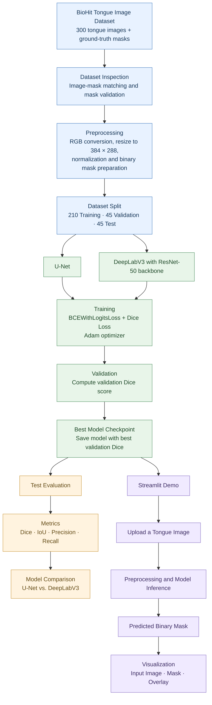

# Tongue Segmentation: U-Net vs. DeepLabV3

A research-oriented tongue image segmentation project that implements and compares two deep learning models, **U-Net** and **DeepLabV3**, and provides an interactive Streamlit demo for visualizing segmentation predictions.

## Overview

Tongue image segmentation aims to identify the tongue region in an image and separate it from the surrounding background. Accurate segmentation can serve as a preprocessing step for downstream tongue image analysis.

This project focuses on:

- Implementing and evaluating U-Net and DeepLabV3 for binary tongue segmentation.
- Comparing model performance using segmentation metrics.
- Visualizing input images, ground-truth masks, and predicted masks.
- Providing an interactive web demo for testing trained models.
- Establishing a baseline for further research into tongue image segmentation.

**Scope:** This project focuses on segmentation and model comparison. It does not claim to diagnose diseases or provide medical advice.

## Models

### U-Net

U-Net is an encoder–decoder convolutional neural network with skip connections between corresponding encoder and decoder stages. These connections help preserve spatial information and support pixel-level segmentation.

The project uses a custom U-Net implementation with three input channels and one output channel.

### DeepLabV3

DeepLabV3 is a semantic segmentation architecture that uses atrous convolution and multi-scale contextual information to predict pixel-level labels.

The project uses a torchvision DeepLabV3 model with a ResNet-50 backbone and a modified classifier for binary segmentation. The model was trained without pretrained weights.

Both models produce logits that are converted into binary masks during inference.

## Dataset

The project currently uses a local dataset of **300 tongue images** and corresponding ground-truth masks.

The dataset is organized as follows:

```text
dataset/
groundtruth/
└── mask/
```

The preprocessing pipeline includes:

1. Loading input images as RGB images.
2. Loading ground-truth masks as grayscale images.
3. Resizing images and masks to a common spatial size of 384 × 288 pixels (width × height).
4. Using bilinear interpolation for input images and nearest-neighbor interpolation for masks.
5. Normalizing image pixel values to the range [0, 1].
6. Converting masks into binary labels.

The dataset is split into training, validation, and test subsets using a fixed random seed of 42.

| Subset | Number of images |
|---|---:|
| Training | 210 |
| Validation | 45 |
| Test | 45 |
| **Total** | **300** |

The dataset source, licensing terms, and original annotation protocol should be documented here once verified. These details are not specified in the current project information.

## Experimental Setup

The current experiments use the following configurations:

| Setting | U-Net | DeepLabV3 |
|---|---|---|
| Input channels | 3 | 3 |
| Output channels | 1 | 1 |
| Epochs configured | 30 | 30 |
| Batch size | 4 | 2 |
| Optimizer | Adam | Adam |
| Learning rate | 0.001 | 0.0001 |
| Loss | BCEWithLogitsLoss + Dice loss | BCEWithLogitsLoss + Dice loss |
| Pretrained weights | No | No |

The saved checkpoints correspond to the best validation Dice scores observed during training.

These settings describe the current experiment. They should not be interpreted as a controlled comparison in which every training variable is identical.

## Evaluation Metrics

The models are evaluated using the following metrics:

- **Dice coefficient:** Measures the overlap between the predicted mask and the ground-truth mask.
- **Intersection over Union (IoU):** Measures the intersection divided by the union of the predicted and ground-truth regions.
- **Precision:** Measures the proportion of predicted positive pixels that are positive in the ground truth.
- **Recall:** Measures the proportion of ground-truth positive pixels recovered by the model.

For binary segmentation:

\[
\mathrm{Dice} = \frac{2TP}{2TP+FP+FN}
\]

\[
\mathrm{IoU} = \frac{TP}{TP+FP+FN}
\]

Here, TP, FP, and FN denote true-positive, false-positive, and false-negative pixels, respectively.

## Current Results

The following results are from the current saved checkpoints and the 45-image test subset.

| Metric | U-Net | DeepLabV3 |
|---|---:|---:|
| Mean Dice | 0.9855 | 0.9824 |
| Mean IoU | 0.9716 | 0.9655 |
| Mean Precision | 0.9864 | 0.9829 |
| Mean Recall | 0.9849 | 0.9822 |
| Best validation Dice | 0.9868 | 0.9850 |
| Best checkpoint epoch | 20 | 28 |

In these preliminary results, U-Net has higher mean Dice and IoU than DeepLabV3 on the current test subset.

**Important evaluation limitation:** The test subset was used during debugging and mask inspection. Therefore, these metrics should be treated as preliminary and exploratory, not as an independent final evaluation. A more rigorous comparison should freeze the evaluation protocol and use a test set that is not consulted during model development.

The current results do not establish that U-Net will outperform DeepLabV3 on other datasets or under different experimental settings.

## Repository Structure

```text
tongue-segmentation/
├── app.py
├── requirements.txt
├── dataset/
├── groundtruth/
│   └── mask/
├── docs/
├── scripts/
│   ├── check_dataset.py
│   └── inspect_masks.py
├── src/
│   ├── data/
│   │   └── dataset.py
│   ├── models/
│   │   ├── unet.py
│   │   └── deeplabv3.py
│   ├── training/
│   │   ├── train_unet.py
│   │   └── train_deeplabv3.py
│   └── evaluation/
│       ├── evaluate.py
│       ├── evaluate_deeplab.py
│       ├── inspect_prediction.py
│       ├── compare_models.py
│       └── summarize_results.py
└── outputs/
    ├── checkpoints/
    ├── metrics/
    └── visualizations/
```

Additional legacy scripts and an older checkpoint may remain in the repository. The structure above highlights the main project components.

### Output files

| Location | Contents |
|---|---|
| `outputs/checkpoints/` | Saved model checkpoints |
| `outputs/metrics/` | CSV evaluation results and model comparison summary |
| `outputs/visualizations/` | Prediction visualizations and mask inspection images |
| `outputs/visualizations/model_comparisons/` | Side-by-side model comparisons |

## Installation

### 1. Clone the repository

```bash
git clone <YOUR_REPOSITORY_URL>
cd tongue-segmentation
```

Replace `<YOUR_REPOSITORY_URL>` with the actual repository URL.

### 2. Create a virtual environment

Windows PowerShell:

```powershell
python -m venv .venv
.\.venv\Scripts\Activate.ps1
```

### 3. Install dependencies

Install PyTorch and torchvision using compatible versions for your Python version and hardware. For GPU acceleration, follow the official PyTorch installation selector:

https://pytorch.org/get-started/locally/

Then install the remaining project dependencies:

```powershell
pip install numpy Pillow streamlit matplotlib tqdm
```

If a complete, tested dependency specification is available, the environment can instead be recreated from a pinned `requirements.txt`. The dependency versions should be verified before claiming exact reproducibility.

### 4. Verify PyTorch

```powershell
python -c "import torch; print('PyTorch:', torch.__version__); print('CUDA available:', torch.cuda.is_available())"
```

CUDA availability depends on the installed PyTorch build, GPU, and driver environment. CPU inference can be used when CUDA is unavailable.

## Running the Demo

The project provides an interactive Streamlit application.

From the repository root, run:

```powershell
streamlit run app.py
```

Streamlit will display a local URL in the terminal. Open that URL in a browser.

The demo allows users to upload a tongue image, select the available segmentation model or models, and inspect the resulting segmentation. The application uses saved checkpoints; training is not required to run the demo when the required checkpoint files are present.

For inference, the project uses the following checkpoint paths:

```text
outputs/checkpoints/best_unet.pth
outputs/checkpoints/best_deeplabv3.pth
```

If a checkpoint is missing, verify that it has been placed at the expected path before starting the application.

## Training

**Warning:** Training takes time and may overwrite an existing best checkpoint. Back up any checkpoint you want to preserve before retraining.

Run the training modules from the repository root:

```powershell
python -m src.training.train_unet
```

```powershell
python -m src.training.train_deeplabv3
```

The training scripts use the configured training and validation split. Check the script configuration before changing epochs, batch size, learning rate, or checkpoint destinations.

## Evaluation and Visualization

The repository includes scripts for model evaluation, prediction inspection, and comparison.

The intended workflow is:

1. Evaluate U-Net and save its per-image metrics.
2. Evaluate DeepLabV3 and save its per-image metrics.
3. Inspect predictions and ground-truth masks.
4. Generate side-by-side model comparisons.
5. Summarize the results in a CSV file.

Relevant scripts include:

```text
src/evaluation/evaluate.py
src/evaluation/evaluate_deeplab.py
src/evaluation/inspect_prediction.py
src/evaluation/compare_models.py
src/evaluation/summarize_results.py
```

Run a script only after checking its arguments, output paths, and imports. Some inspection scripts may be configured for specific sample images rather than the entire dataset.


## End-to-End Pipeline

The project follows an end-to-end workflow covering dataset preparation, model training, quantitative evaluation, and interactive inference.

### 1. Pipeline Overview



### 2. Dataset Preparation

The project uses the BioHit tongue image dataset, containing 300 tongue images and corresponding ground-truth masks.

The preparation stage includes:

- Matching input images with their corresponding masks.
- Inspecting mask values and correcting known mask polarity inconsistencies.
- Converting input images to RGB format.
- Resizing images and masks to a consistent spatial resolution of 384 × 288 pixels.
- Normalizing image pixel values to the range [0, 1].
- Converting ground-truth masks into binary segmentation targets.

The dataset is split into three subsets:

| Subset | Number of images | Purpose |
|---|---:|---|
| Training | 210 | Optimize model parameters |
| Validation | 45 | Monitor training and select the best checkpoint |
| Test | 45 | Evaluate model performance |

The split uses a fixed random seed of 42 for reproducibility.

### 3. Model Training

Two segmentation architectures are implemented and evaluated:

- **U-Net:** A compact encoder-decoder segmentation network with skip connections.
- **DeepLabV3:** A segmentation model using a ResNet-50 backbone.

Both models produce a single-channel output representing tongue-region segmentation logits.

The training procedure uses:

- **Loss function:** Binary Cross-Entropy with Logits combined with Dice Loss.
- **Optimizer:** Adam.
- **Checkpoint selection:** The model checkpoint with the highest validation Dice score.
- **Training duration:** Up to 30 epochs per model.

The saved checkpoints are used for subsequent evaluation and inference.

### 4. Model Evaluation

The selected checkpoints are evaluated using segmentation metrics:

- **Dice Score:** Measures overlap between the predicted mask and the ground-truth mask.
- **Intersection over Union (IoU):** Measures the intersection divided by the union of the predicted and ground-truth regions.
- **Precision:** Measures the proportion of predicted tongue pixels that are correctly classified.
- **Recall:** Measures the proportion of ground-truth tongue pixels that are successfully detected.

Evaluation results are saved as CSV files under `outputs/metrics/`. Visual predictions and model comparisons are stored under `outputs/visualizations/`.

The current evaluation results are preliminary because the test subset was also used during dataset and mask debugging. An independent final evaluation should be conducted before treating these results as definitive.

### 5. Interactive Inference Demo

The project provides a Streamlit application for interactive tongue segmentation.

The inference workflow is:

1. Launch the Streamlit application.
2. Upload a tongue image.
3. Select U-Net, DeepLabV3, or both models.
4. Apply the same preprocessing required by the selected model.
5. Load the trained checkpoint and perform inference.
6. Convert the model output logits into a binary segmentation mask.
7. Display the input image, predicted mask, and segmentation overlay.
8. Download the generated mask or overlay image.

The demo uses pretrained project checkpoints generated during local training. It does not retrain the models when a user uploads an image.

### 6. Pipeline Outputs

| Stage | Output |
|---|---|
| Dataset preparation | Validated image-mask pairs |
| Model training | Best U-Net and DeepLabV3 checkpoints |
| Evaluation | CSV files containing segmentation metrics |
| Visualization | Prediction images and model comparison figures |
| Interactive demo | Predicted masks and overlay images |

This pipeline supports reproducible experimentation, quantitative comparison between segmentation models, and qualitative inspection through an interactive application.


## Research Limitations

The current implementation is a baseline for further experimentation. Important limitations include:

- The dataset contains 300 images, so the evaluation may not represent broader populations or imaging conditions.
- The dataset provenance, licensing, and annotation protocol need to be documented.
- The current test subset was consulted during debugging; independent final evaluation is still needed.
- The current model comparison uses different learning rates and batch sizes.
- The experiments do not establish clinical validity or diagnostic performance.
- Reproducibility requires recording the exact dependency versions, hardware, random seeds, and final experiment configurations.

## Future Work

Potential next steps include:

1. Review published tongue segmentation methods and publicly documented datasets.
2. Compare existing approaches using a consistent experimental protocol.
3. Establish an independent evaluation set and freeze it before final testing.
4. Investigate difficult cases, boundary errors, and variation in image quality.
5. Record per-image metrics and qualitative failure cases.
6. Document dataset provenance, annotation quality, and licensing.
7. Explore additional segmentation architectures only when justified by the literature review and available resources.

These are proposed directions, not completed experiments or established research findings.

## Acknowledgements and References

No external papers or dataset citations are included in this README because the relevant sources have not yet been verified. Add the original dataset citation, model papers, and any third-party implementation references here after checking the source material.

## License

No license has been specified for this project or its dataset. Before publishing the repository, choose an appropriate code license and confirm that the dataset can legally be redistributed.
